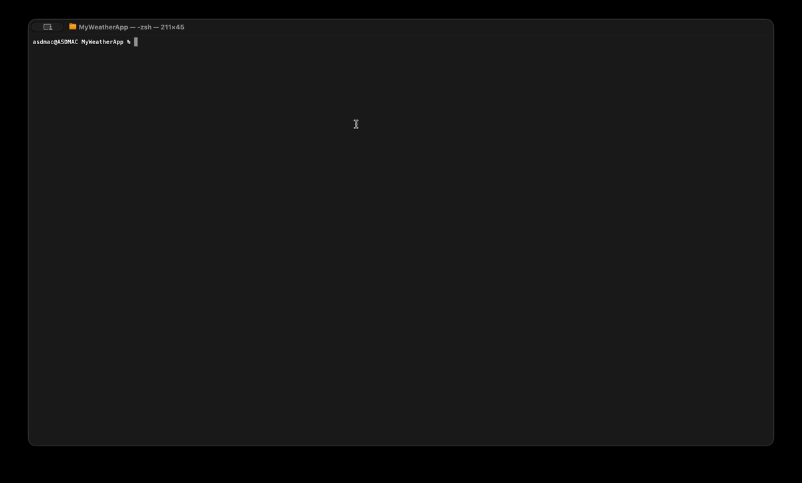

# MyWeatherApp

Мое консольное приложение на С# (.NET 10). Читает список городов из файла [`Cities.txt`](Cities.txt), 
Получает погоду, выводит температуру по каждому городу и статистику по странам

## Что считается по каждой стране

| Показатель | Описание |
|---|---|
| Количество городов | сколько городов из списка относится к стране |
| Средняя температура | среднее значение, округлённое до целого |
| Минимальная температура | самый холодный город страны |
| Максимальная температура | самый тёплый город страны |


## Для запуска
```zsh
dotnet build
```
```zsh
dotnet run
```

## Пример работы



```
Moscow, Russia +11 °C
Vienna, Austria +15 °C
...

Austria — 2 cities, avg: +12 °C, min: +9 °C, max: +15 °C
Russia — 5 cities, avg: +9 °C, min: +7 °C, max: +11 °C
```

## Технические детали

- JSON разбирается через `System.Text.Json`, внешние пакеты не используются.
- Список городов очищается от пробелов и дубликатов (без учёта регистра).


By asdwert7 программа открыта и без лицензии. 
